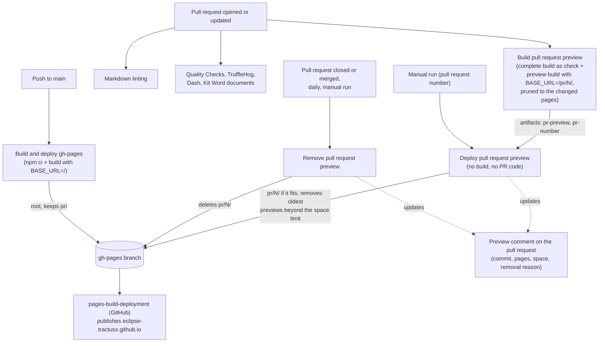
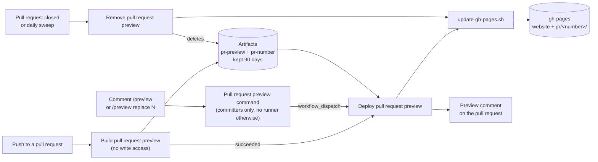
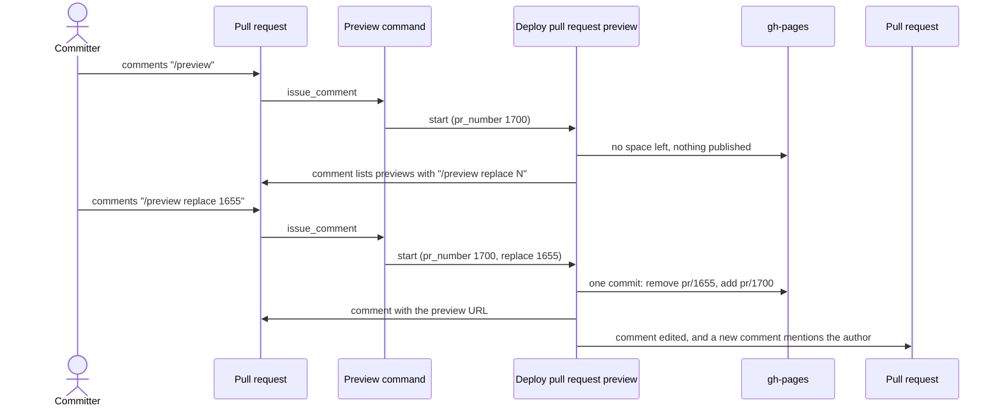
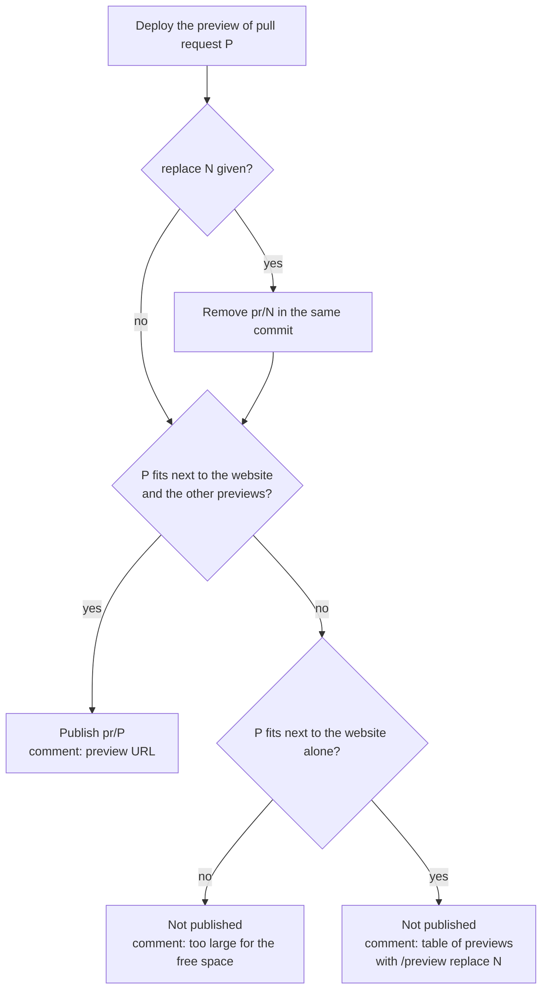
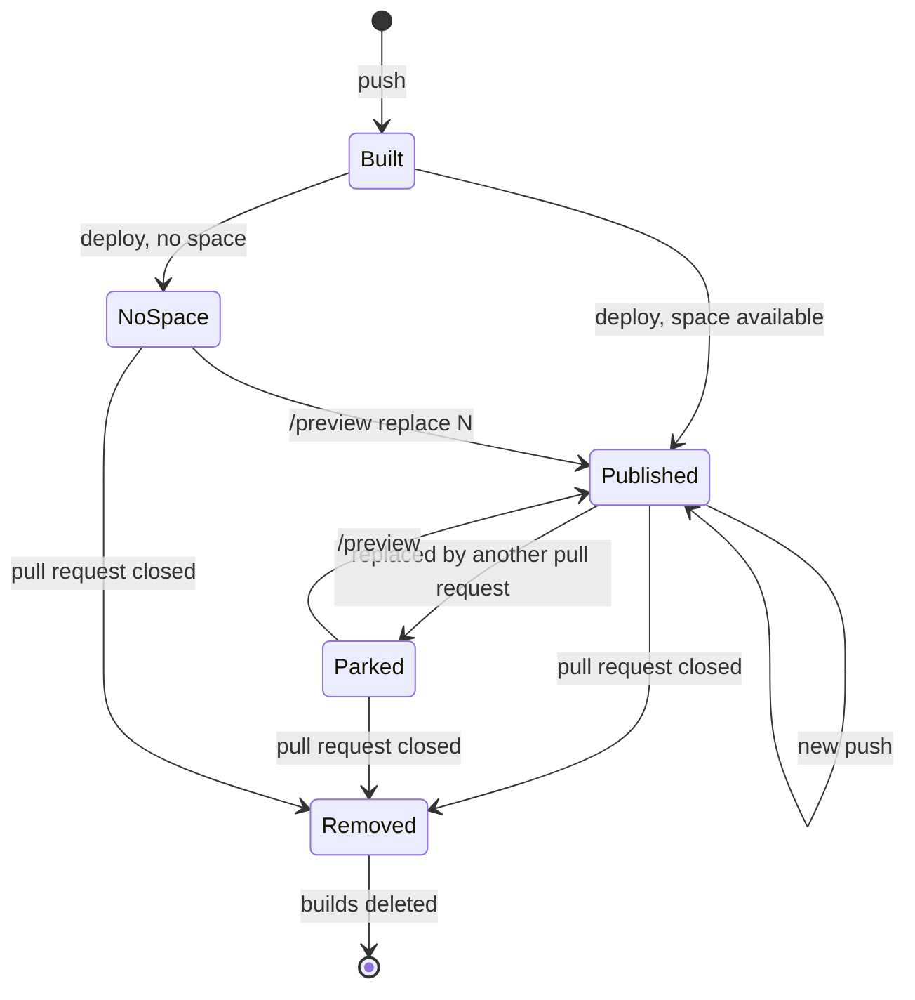

# GitHub Actions workflows

This folder holds the CI/CD workflows of the Eclipse Tractus-X website. This page explains what each workflow does,
when it runs and how the workflows depend on each other.

## Overview

| Workflow (file) | Trigger | Purpose | Writes to `gh-pages` |
|---|---|---|---|
| [Build and deploy gh-pages](build-and-deploy-gh-pages.yaml) | push to `main` | Builds and publishes the production site | yes (root) |
| [Build pull request preview](verify-build.yaml) | pull request to `main`; `/preview` on a pull request to another branch | Checks that the complete site builds (pull requests to `main` only), produces a preview with only the changed pages | no |
| [Deploy pull request preview](deploy-pr-preview.yaml) | "Build pull request preview" completed, manual | Publishes the preview of a pull request | yes (`pr/<number>/`) |
| [Remove pull request preview](cleanup-pr-preview.yaml) | pull request closed or merged, daily, manual | Deletes the preview of a pull request, or of all closed pull requests | yes (`pr/`) |
| [Markdown linting for documentation](lint-on-pull-request.yaml) | pull request to `main` | Runs markdownlint on `docs/` and `docs-kits/kits/` | no |
| [Quality Checks (Release Guidelines)](quality-checks.yaml) | every pull request, manual | Tractus-X release guideline checks | no |
| [3rd Party dependency check (Eclipse Dash)](dash.yaml) | pull request changing `package*.json`, manual | License check of npm dependencies | no |
| [TruffleHog](trufflehog.yml) | push to `main`, pull request | Scans the new commits for leaked secrets | no |
| [TruffleHog (full history)](trufflehog-full.yml) | weekly, manual | Scans the full history of `main` for leaked secrets | no |
| [Generate Kit Template Documents](generate-kit-word.yaml) | pull request changing the KIT template, manual | Generates the KIT template Word documents | no |

`pages-build-deployment` also shows up in the Actions tab. It is not defined here: GitHub runs it on every push to
`gh-pages` to publish that branch to <https://eclipse-tractusx.github.io>. It takes several minutes, and a newer run
cancels an older one that has not finished.

## How the website workflows work together



### Two builds per pull request, one per merge

- **Pull request:** "Build pull request preview" builds the site twice, in two parallel jobs:
  - `Build static website` builds the complete site, exactly like production. It verifies that the site builds (broken
    links fail the build, although `npm start` may not show them) and is a required status check. Its output is not
    kept.
  - `Build preview` builds the site with the base URL `/pr/<number>/` and removes every page the pull request does not
    change. Its output is the preview. "Deploy pull
    request preview" does not build anything; it publishes the artifact of that job. Removing the job would therefore
    remove the previews.
- **Merge to `main`:** the site is built again in "Build and deploy gh-pages". This is not redundant: the preview was
  built with the base URL `/pr/<number>/` and from the pull request at that time, while production needs the base URL
  `/` and the current state of `main`.

### Pull request previews at a glance

Five pieces work together. Only the build touches the pull request's code, and it has no write access; everything
that writes runs from `main` and only handles the build's output.

| Piece | Runs when | Trusts PR code? | Does |
|---|---|---|---|
| `verify-build.yaml` (Build pull request preview) | push to a pull request to `main` that changes the website, or started by `/preview` for a pull request to another branch | runs it, without write access, and without the npm cache when started by `/preview` | builds the pruned preview, uploads the artifacts `pr-preview` and `pr-number` (kept 90 days) |
| `deploy-pr-preview.yaml` | build succeeded, or started by `/preview` | no | downloads the artifact and publishes it to `gh-pages` under `pr/<number>/`, updates the comments |
| `pr-preview-command.yaml` | a committer's comment starting with `/preview` | no | starts the deploy with `pr_number` and `replace`, or the build when the current commit has none (pull requests to another branch than `main`), or with `/preview rebuild` re-runs an expired build; `/preview large` publishes an oversized preview; reacts 🚀 or 😕 |
| `cleanup-pr-preview.yaml` | pull request closed, daily, by hand | no | removes previews of closed pull requests and deletes their builds |
| `update-gh-pages.sh` | called by the workflows above | no | applies one change to `gh-pages`, checks the space, retries if another workflow pushed first |



#### Pull requests that do not change the website

The first job of the build, "Check for website changes", looks at the files the pull request changes. If none of them
is used by the website build, both builds are skipped and there is no preview. Such files are everything under
`.github/` (except `verify-build.yaml` itself, so changes to the build can be tested), the Markdown files in the root of
the repository (`README.md`, `CHANGELOG.md`, ...), `LICENSE`, `LICENSE_non-code`, `DEPENDENCIES`, `CODEOWNERS`,
`.tractusx` and the editor and Git settings. A skipped job counts as passed, so the required check
`Build static website` does not block these pull requests. As soon as one other file changes, everything builds as usual.

#### Requesting and replacing a preview

Committers can publish a preview from a comment on the pull request:

- `/preview` publishes the preview of the pull request's latest successful build. Pull requests to another branch than
  `main` (stacked pull requests) are not built on push, to save Actions minutes. For them, `/preview` builds the current
  commit first and the build publishes the preview when it has finished. The result is reported like for any other
  `/preview`, including the table of previews to replace when GitHub Pages has no space left. The build of a stacked
  pull request is the merge into its base branch, so the preview shows the stack up to that pull request. It only runs
  the preview build, not the complete build that is a required check for `main`.
- `/preview replace <number>` removes the preview of pull request `<number>` and publishes this one in its place, in one
  commit.



- `/preview rebuild` builds the pull request again when its saved build has expired (builds are kept for 90 days). The
  build publishes the preview when it has finished.
- `/preview large` publishes a preview that is larger than `MAX_PREVIEW_MB` (300 MB), as long as GitHub Pages as a whole
  has space for it. Replacing other previews does not help a preview that is too large: the limit is per preview.

A build is never run again on its own, to save Actions minutes. When a committer comments `/preview` and the build has
expired, the bot replies that it has expired and points to `/preview rebuild`. If the build has not finished yet, the
bot reacts with 👀 and the build publishes the preview when it is done; a pull request that does not change the website
gets 😕.

The command workflow runs no pull request code and starts nothing but "Deploy pull request preview" and, for pull
requests to another branch than `main`, "Build pull request preview" (which has no write access and no secrets). Only committers,
meaning people with write access to the repository, can use it. A first filter decides before a runner starts: comments
from people who never contributed do not start a runner and get no answer, so the command cannot be used to flood a
pull request with bot comments or to use up Actions minutes. `CONTRIBUTOR` passes this filter, because GitHub reports
org members whose membership is private, as most Eclipse committers have it, as `CONTRIBUTOR` and not as `MEMBER`. The
script then reads the real permission on the repository and silently ignores everyone without write access.

A committer always sees what happened to their command:

| Reaction or reply | Meaning |
|---|---|
| 👀 | the command was picked up (a few seconds after the comment, while a runner starts) |
| 🚀 | the deployment, or with `/preview rebuild` the build, has started |
| 😕 | the command is not valid, or the pull request has no preview (closed, no website changes) |
| 🎉 | the preview is published |
| 👎 | the preview was not published |

Next to the reactions, the bot answers every command of a committer with one status comment, a few seconds after the
command. It quotes the command and says what happens, how long it usually takes and why:

| Status | Meaning |
|---|---|
| 👀 On it | the command was picked up, the bot looks for the build |
| 🚀 Publishing | the deployment has started; it usually takes 2 to 5 minutes: a runner downloads the build, the preview is copied to `gh-pages` (waiting if another deployment writes there at the same moment) and GitHub Pages puts it online |
| ⏳ Build still running | the preview is made from the build of the latest commit, which had not finished; it publishes the preview on its own, usually 3 to 5 minutes after the push |
| 🔨 Building | there was no build of the current commit (pull request to another branch than `main`), so the build was started; it publishes the preview when it has finished, 5 to 10 minutes in total |
| 🔁 Building again | `/preview rebuild` started the build again; expect 5 to 10 minutes until the preview is online |
| 😕 or ⌛ | nothing to publish, and why: not a valid command, closed pull request, no website changes, expired build |

When the build and the deployment have finished, the result is written into the same status comment, and the `/preview`
comment gets 🎉 or 👎:

- 🎉 the link. The deployment first waits until GitHub Pages serves the preview (up to 10 minutes) and says so if it
  does not yet.
- ❌ the build or the deployment failed, with a link to the run that shows why.
- 📦 the preview is larger than a single preview may be; `/preview large` publishes it anyway.
- 💾 GitHub Pages has no space left: a table of the current previews with their sizes and a `/preview replace <number>`
  command for each, so the committer chooses which one makes way. The replacement reuses the build.

A status comment that still waits ("Build still running", "Building", "Publishing") is finished by the next deployment of
that pull request, also when it was started by a push and not by the command. GitHub does not notify about edited
comments; the reaction on the `/preview` comment shows the outcome at a glance. Only committers cause status
comments, so they cannot be used to flood a pull request. Pull requests from forks work the same way, once their build has run (GitHub asks a maintainer to approve
the first workflow run of a new contributor).

#### When there is no space

Previews of other pull requests are not removed automatically. `update-gh-pages.sh` decides like this (the deploy sets
`PREVIEW_EVICT=none`; the production deployment and the daily sweep keep evicting the oldest previews, because the
website always gets the space):



#### Life of a preview

A replaced preview is parked, not lost: its build artifact stays for 90 days, so `/preview` publishes it again without
a rebuild. Only closing the pull request deletes the builds.



| Event | Preview on `gh-pages` | Build artifact | Comment |
|---|---|---|---|
| push, space available | published (replaces the older one) | new, 90 days | URL, commit, changed pages |
| push, no space | not published | kept | previews table with replace commands |
| `/preview replace N` | N removed, this one published | both kept | this PR: URL; PR N: edited, plus a new comment mentioning the author |
| `/preview` on a parked PR | published again | reused | URL |
| pull request closed | removed | deleted | "closed" |

### What the preview contains

The previews and the production site share the `gh-pages` branch and with it the
[size limit of GitHub Pages](https://docs.github.com/en/pages/getting-started-with-github-pages/github-pages-limits).
A complete build is well over 1 GB, mostly because of the frozen KIT releases in `docs-kits_versioned_docs/`. With
complete previews, a few open pull requests were enough to exceed the limit, and then not even the production site
could be published.

A preview therefore only contains what the pull request changes. Every other path of the preview falls back to the
live website:

1. `Build preview` builds the site with the base URL `/pr/<number>/`. It only builds the KIT versions `Next`, the latest
   release (both are needed so every KIT page keeps its path) and older releases that the pull request changes in
   `docs-kits_versioned_docs/` or `docs-kits_versioned_sidebars/`. They are selected with the environment variable
   `DOCS_KITS_VERSIONS` of [`docusaurus.config.js`](../../docusaurus.config.js).
2. [`utils/prune-preview.js`](../../utils/prune-preview.js) then removes the pages that the changed files
   (`git diff` of the pull request) do not affect, with their page chunks and the images that only they use:
   - a changed Markdown page keeps itself; another changed file in a content folder (an image, a partial) keeps the
     pages of its folder,
   - a change inside a KIT keeps that whole KIT in that version,
   - blog lists, tags and feeds are kept only if the pull request changes that blog, and only their first page,
   - a change outside the content folders (components, styles, `data/`, `static/`, configuration) can affect every
     page, so it keeps all pages except the older KIT releases,
   - changes that do not end up on the website (`.github/`, `README.md`, ...) only keep the home page.

   It writes the affected pages to `.preview-pages.json`; the preview comment links them.

   Images, downloads and large static files that the pull request does not change are then taken out of the preview
   as well: the kept pages load them from the live website (`/pr/<number>/assets/images/x-<hash>.png` becomes
   `/assets/images/x-<hash>.png`). Webpack names these files after their content, so an unchanged file has the very
   same path on the live website. A file is only taken out if every reference to it could be rewritten. The catch:
   such a preview shows the live version of those files, so once `main` changes or removes one, older previews show
   the new version or none.
3. GitHub Pages answers a path that does not exist with the `404.html` at the root, which belongs to the production
   site. A small script in the production pages sends every `/pr/<number>/<path>` that ends there to `/<path>` on the
   live website. Navigating inside the preview to a removed page also ends there: Docusaurus cannot load the page
   and reloads it. The preview's announcement bar tells visitors which pull request they are looking at.

A preview with only content changes is a few dozen MB instead of over 1 GB.

### Space on GitHub Pages

Every write to `gh-pages` checks the space, so previews can never stop the production site from being published:

- **`MAX_PREVIEW_MB`** (300) in "Deploy pull request preview": a larger preview is not published, and an older preview
  of the pull request is removed. The comment links the build, whose `pr-preview` artifact can be served locally, and
  says that a committer can publish it anyway with `/preview large`. The space limit below still applies to it.
- **`GH_PAGES_LIMIT_MB`** (2500, `0` turns the check off) in
  [`update-gh-pages.sh`](../scripts/update-gh-pages.sh): the space the production site and all previews may use
  together. Published Pages artifacts of about 3.3 GB still deployed, larger ones failed. Before pushing, the script
  measures the production site and the previews:
  - a preview that does not fit next to the production site on its own is not published (and its older version is
    removed). The comment says so, and no other preview is removed for it,
  - a preview that only fits if other previews make space is not published either; the comment lists the previews so
    a committer can choose one with `/preview replace <number>` (see "When there is no space" above),
  - the production deployment and the daily sweep still remove the oldest previews (by `pr/<number>/.deployed-at`)
    until everything fits; the website always gets the space. The author of each removed preview gets a new comment
    that mentions them, and `/preview` publishes it again once there is space.
- Each run shows the space used in its job summary.

Every pull request has one preview comment, which is updated (not posted again):

- after a deployment, with the commit the preview was built from, the time, the build, the changed pages and the space
  on GitHub Pages,
- when the preview is not published (too large, no space), with the reason and the commit,
- when the preview is removed, with the reason (pull request closed, removed manually, replaced by another pull
  request, removed to make space for the website) and the commit of the last preview. A replaced preview's author also
  gets a new comment that mentions them, because GitHub does not notify about edited comments.

The preview's announcement bar also shows the commit.

To publish or remove a preview by hand, run the workflows from the Actions tab or with `gh`:

```bash
# Publishes the latest build of the pull request's current commit again (same as commenting /preview).
gh workflow run deploy-pr-preview.yaml -f pr_number=1234
# Removes one preview, or without a number the previews of all closed pull requests.
gh workflow run cleanup-pr-preview.yaml -f pr_number=1234
gh workflow run cleanup-pr-preview.yaml
```

The build keeps its artifacts for 90 days, or until the pull request is closed. After that, comment `/preview rebuild`, re-run
the build or push a new commit. Once a day, "Remove pull request preview" removes the previews of closed pull requests that are still there and checks the
space limit.

The `Build preview` job reports the size of the preview as a notice in the workflow run. To build and prune a preview
locally:

```bash
BASE_URL=/pr/1234/ DOCS_KITS_VERSIONS=current npm run build
git diff --name-only main... > changed-files.txt
node utils/prune-preview.js --changed-files changed-files.txt
```

The fallback to the live website needs the production `404.html`, so `npm run serve` shows "Page not found" for the
removed pages instead.

### Why the preview needs two workflows

A pull request from a fork must not get write access to the repository, because its code runs in the build. The work is
therefore split:

1. **Build pull request preview** runs the pull request's code with read-only permissions and no secrets. It uploads
   the preview build (`pr-preview`) and the pull request number (`pr-number`) as artifacts.
2. **Deploy pull request preview** is started by the completion of the build (`workflow_run`) and runs with write
   access, in the context of the base repository. It never checks out or runs code from the pull request. It treats the
   artifacts as untrusted input: the pull request number must be a plain number, and that pull request's latest commit
   must be the commit the build was made from. Otherwise the build is skipped as outdated or not belonging to that pull
   request.

A `workflow_run` workflow always runs in the version of the default branch. Changes to "Deploy pull request preview"
therefore only take effect after they are merged, and the pull request that changes it gets no preview from the new
version.

### Layout of the `gh-pages` branch

```text
gh-pages
├── index.html, assets/, docs/, ...   production site, replaced by "Build and deploy gh-pages"
└── pr/
    ├── 1605/                         preview of pull request 1605
    └── 1627/                         preview of pull request 1627
```

The previews are available at `https://eclipse-tractusx.github.io/pr/<number>/`. Each deployment replaces its whole
target, so pages and hashed assets that no longer exist do not pile up:

- the production deployment replaces everything at the root except `pr/`,
- a preview deployment replaces only `pr/<number>/` (and removes the oldest previews beyond the space limit),
- the removal deletes only the selected `pr/<number>/` folders.

### Writing to `gh-pages` concurrently

All three writing workflows use [`.github/scripts/update-gh-pages.sh`](../scripts/update-gh-pages.sh). It fetches the
latest `gh-pages` commit (files only, no history), applies the change on top of it and pushes it. If another workflow
pushed in the meantime, the push is rejected; the script then fetches the new state, applies the change again and
retries (up to 10 times, with an increasing delay). Because every workflow only touches its own part of the branch,
nothing gets lost. If `gh-pages` does not exist yet, for example in a fork, the script creates it.

Concurrency groups only order the runs that must not overlap:

| Group | Used by | Effect |
|---|---|---|
| `gh-pages-production` | Build and deploy gh-pages | Production deployments run one after the other, so an older build never overwrites a newer one. A waiting deployment is replaced by a newer one, which contains its changes. |
| `gh-pages-pr-<number>` | deploy job of Deploy pull request preview, Remove pull request preview | Deployment and removal of the same preview never overlap. If a removal is replaced by a later deployment, that deployment sees the closed pull request and removes the preview itself. The daily and manual removal of all closed pull requests uses `gh-pages-pr-sweep`. |
| `verify-build-<number>` | Build pull request preview | A new push to a pull request cancels the running build of the previous push. |

Production deployments and previews of different pull requests do not wait for each other.

> GitHub keeps at most one *waiting* run per concurrency group and cancels the previous waiting run when another one
> arrives. Previously all three workflows shared one group, which could cancel a production deployment or a preview
> removal. That is why the groups are now separate.

### Testing changes to the preview workflows

Because "Deploy pull request preview" always runs in the version of the default branch, a pull request to this
repository cannot test changes to it. Test such changes in your fork instead:

1. Enable GitHub Actions in your fork and push the changed workflows to the fork's `main` branch.
2. Open a pull request inside your fork (from a branch of the fork to the fork's `main`).
3. Check that "Build pull request preview" and then "Deploy pull request preview" succeed in the fork, that
   `pr/<number>/` appears on the fork's `gh-pages` branch (created on the first run) and that the preview comment is
   posted. Closing the pull request must remove `pr/<number>/` again.

The preview URL in the comment points to `eclipse-tractusx.github.io`, and the site is built for that host, so check
the content of the `gh-pages` branch rather than a Pages site of the fork. Pushing to the fork's `main` also runs the
production deployment into the fork's `gh-pages` branch.

## The other workflows

### Markdown linting for documentation

Runs `npm run lint-doc` and `npm run lint-kits` (markdownlint with [`.markdownlint.yaml`](../../.markdownlint.yaml))
on every pull request to `main`. Run the same commands locally before opening a pull request.

### Quality Checks (Release Guidelines)

Calls the reusable workflow `reusable-quality-checks.yaml` from
[eclipse-tractusx/sig-infra](https://github.com/eclipse-tractusx/sig-infra), which checks the repository against the
Tractus-X release guidelines (TRGs). Runs on every pull request and can be started manually.

### 3rd Party dependency check (Eclipse Dash)

Runs the [Eclipse Dash License Tool](https://github.com/eclipse-dash/dash-licenses) through the `run-dash` action of
sig-infra on `package-lock.json`. Runs when a pull request changes `package.json` or `package-lock.json`, and fails if
a dependency has a restricted license. Can be started manually.

### TruffleHog

Scans for leaked secrets with [TruffleHog](https://github.com/trufflesecurity/trufflehog) and reports verified and
unknown findings. It only scans the commits that are new: for a pull request the commits between its base and head,
for a push to `main` the pushed commits. The checkout is shallow, with just enough history for those commits, instead of
the full history of all branches. `--fail-on-scan-errors` makes the check fail when TruffleHog cannot scan, instead of
passing with nothing scanned.

### TruffleHog (full history)

Scans the full history of `main` every Monday at 03:00 (UTC) and it manually only fetches `main`, not `gh-pages` with
the pull request previews or other branches. It is not a required check.

### Generate Kit Template Documents

Generates the Word documents of the KIT templates (`docs-kits/kit-template/graduated` and `.../sandbox`) with
[`scripts/generate_kit_word.py`](../../scripts/generate_kit_word.py). It detects which template changed and only
regenerates that one. The documents are uploaded as the workflow artifact `kit-template-documents` (kept 30 days) and
are not committed. Can be started manually for one or both templates.

## Required status checks

Branch protection of `main` requires these checks. They are identified by their **job names**, so keep the job names
when changing a workflow:

| Check | Job in |
|---|---|
| `Build static website` | [verify-build.yaml](verify-build.yaml) |
| `Run markdown lint` | [lint-on-pull-request.yaml](lint-on-pull-request.yaml) |
| `Scan secrets` | [trufflehog.yml](trufflehog.yml) |
| `Check quality guidelines / Check quality guidelines` | [quality-checks.yaml](quality-checks.yaml) |

## NOTICE

This work is licensed under the [CC-BY-4.0](https://creativecommons.org/licenses/by/4.0/legalcode).

- SPDX-License-Identifier: CC-BY-4.0
- SPDX-FileCopyrightText: 2026 Contributors to the Eclipse Foundation
- Source URL: <https://github.com/eclipse-tractusx/eclipse-tractusx.github.io>
