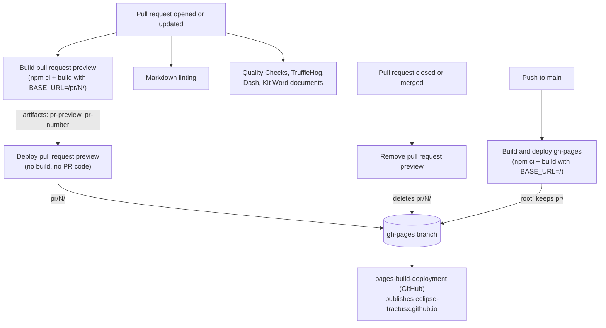

# GitHub Actions workflows

This folder holds the CI/CD workflows of the Eclipse Tractus-X website. This page explains what each workflow does,
when it runs and how the workflows depend on each other.

## Overview

| Workflow (file) | Trigger | Purpose | Writes to `gh-pages` |
|---|---|---|---|
| [Build and deploy gh-pages](build-and-deploy-gh-pages.yaml) | push to `main` | Builds and publishes the production site | yes (root) |
| [Build pull request preview](verify-build.yaml) | pull request to `main` | Checks that the site builds, produces the preview | no |
| [Deploy pull request preview](deploy-pr-preview.yaml) | "Build pull request preview" completed | Publishes the preview of a pull request | yes (`pr/<number>/`) |
| [Remove pull request preview](cleanup-pr-preview.yaml) | pull request closed or merged | Deletes the preview of a pull request | yes (`pr/<number>/`) |
| [Markdown linting for documentation](lint-on-pull-request.yaml) | pull request to `main` | Runs markdownlint on `docs/` and `docs-kits/kits/` | no |
| [Quality Checks (Release Guidelines)](quality-checks.yaml) | every pull request, manual | Tractus-X release guideline checks | no |
| [3rd Party dependency check (Eclipse Dash)](dash.yaml) | pull request changing `package*.json`, manual | License check of npm dependencies | no |
| [TruffleHog](trufflehog.yml) | push to `main`, pull request, daily, manual | Scans for leaked secrets | no |
| [Generate Kit Template Documents](generate-kit-word.yaml) | pull request changing the KIT template, manual | Generates the KIT template Word documents | no |

`pages-build-deployment` also shows up in the Actions tab. It is not defined here: GitHub runs it on every push to
`gh-pages` to publish that branch to <https://eclipse-tractusx.github.io>. It takes several minutes, and a newer run
cancels an older one that has not finished.

## How the website workflows work together



### One build per pull request, one per merge

- **Pull request:** the site is built once, in "Build pull request preview". That build serves two purposes. It
  verifies that the site builds (broken links fail the build, although `npm start` may not show them), and its output
  is the preview. "Deploy pull request preview" does not build anything; it publishes the artifact of that run.
  Removing "Build pull request preview" would therefore remove the previews as well.
- **Merge to `main`:** the site is built again in "Build and deploy gh-pages". This is not redundant: the preview was
  built with the base URL `/pr/<number>/` and from the pull request at that time, while production needs the base URL
  `/` and the current state of `main`.

### Why the preview needs two workflows

A pull request from a fork must not get write access to the repository, because its code runs in the build. The work is
therefore split:

1. **Build pull request preview** runs the pull request's code with read-only permissions and no secrets. It uploads
   the build output (`pr-preview`) and the pull request number (`pr-number`) as artifacts.
2. **Deploy pull request preview** is started by the completion of the build (`workflow_run`) and runs with write
   access, in the context of the base repository. It never checks out or runs code from the pull request. It treats the
   artifacts as untrusted input: the pull request number must be a plain number, and that pull request's latest commit
   must be the commit the build was made from. Otherwise the build is skipped as outdated or not belonging to that pull
   request.

A `workflow_run` workflow always runs in the version of the default branch. Changes to "Deploy pull request preview"
therefore only take effect after they are merged, and the pull request that changes it gets no preview from the new
version.

### Layout of the `gh-pages` branch

```text
gh-pages
├── index.html, assets/, docs/, ...   production site, replaced by "Build and deploy gh-pages"
└── pr/
    ├── 1605/                         preview of pull request 1605
    └── 1627/                         preview of pull request 1627
```

The previews are available at `https://eclipse-tractusx.github.io/pr/<number>/`. Each deployment replaces its whole
target, so pages and hashed assets that no longer exist do not pile up:

- the production deployment replaces everything at the root except `pr/`,
- a preview deployment replaces only `pr/<number>/`,
- the removal deletes only `pr/<number>/`.

### Writing to `gh-pages` concurrently

All three writing workflows use [`.github/scripts/update-gh-pages.sh`](../scripts/update-gh-pages.sh). It fetches the
latest `gh-pages` commit (files only, no history), applies the change on top of it and pushes it. If another workflow
pushed in the meantime, the push is rejected; the script then fetches the new state, applies the change again and
retries (up to 10 times, with an increasing delay). Because every workflow only touches its own part of the branch,
nothing gets lost. If `gh-pages` does not exist yet, for example in a fork, the script creates it.

Concurrency groups only order the runs that must not overlap:

| Group | Used by | Effect |
|---|---|---|
| `gh-pages-production` | Build and deploy gh-pages | Production deployments run one after the other, so an older build never overwrites a newer one. A waiting deployment is replaced by a newer one, which contains its changes. |
| `gh-pages-pr-<number>` | deploy job of Deploy pull request preview, Remove pull request preview | Deployment and removal of the same preview never overlap. If a removal is replaced by a later deployment, that deployment sees the closed pull request and removes the preview itself. |
| `verify-build-<number>` | Build pull request preview | A new push to a pull request cancels the running build of the previous push. |

Production deployments and previews of different pull requests do not wait for each other.

> GitHub keeps at most one *waiting* run per concurrency group and cancels the previous waiting run when another one
> arrives. Previously all three workflows shared one group, which could cancel a production deployment or a preview
> removal. That is why the groups are now separate.

### Testing changes to the preview workflows

Because "Deploy pull request preview" always runs in the version of the default branch, a pull request to this
repository cannot test changes to it. Test such changes in your fork instead:

1. Enable GitHub Actions in your fork and push the changed workflows to the fork's `main` branch.
2. Open a pull request inside your fork (from a branch of the fork to the fork's `main`).
3. Check that "Build pull request preview" and then "Deploy pull request preview" succeed in the fork, that
   `pr/<number>/` appears on the fork's `gh-pages` branch (created on the first run) and that the preview comment is
   posted. Closing the pull request must remove `pr/<number>/` again.

The preview URL in the comment points to `eclipse-tractusx.github.io`, and the site is built for that host, so check
the content of the `gh-pages` branch rather than a Pages site of the fork. Pushing to the fork's `main` also runs the
production deployment into the fork's `gh-pages` branch.

## The other workflows

### Markdown linting for documentation

Runs `npm run lint-doc` and `npm run lint-kits` (markdownlint with [`.markdownlint.yaml`](../../.markdownlint.yaml))
on every pull request to `main`. Run the same commands locally before opening a pull request.

### Quality Checks (Release Guidelines)

Calls the reusable workflow `reusable-quality-checks.yaml` from
[eclipse-tractusx/sig-infra](https://github.com/eclipse-tractusx/sig-infra), which checks the repository against the
Tractus-X release guidelines (TRGs). Runs on every pull request and can be started manually.

### 3rd Party dependency check (Eclipse Dash)

Runs the [Eclipse Dash License Tool](https://github.com/eclipse-dash/dash-licenses) through the `run-dash` action of
sig-infra on `package-lock.json`. Runs when a pull request changes `package.json` or `package-lock.json`, and fails if
a dependency has a restricted license. Can be started manually.

### TruffleHog

Scans the repository history for leaked secrets with [TruffleHog](https://github.com/trufflesecurity/trufflehog), only
reporting verified findings. Runs on pushes to `main`, on pull requests, daily at midnight (UTC) and manually.

### Generate Kit Template Documents

Generates the Word documents of the KIT templates (`docs-kits/kit-template/graduated` and `.../sandbox`) with
[`scripts/generate_kit_word.py`](../../scripts/generate_kit_word.py). It detects which template changed and only
regenerates that one. The documents are uploaded as the workflow artifact `kit-template-documents` (kept 30 days) and
are not committed. Can be started manually for one or both templates.

## Required status checks

Branch protection of `main` requires these checks. They are identified by their **job names**, so keep the job names
when changing a workflow:

| Check | Job in |
|---|---|
| `Build static website` | [verify-build.yaml](verify-build.yaml) |
| `Run markdown lint` | [lint-on-pull-request.yaml](lint-on-pull-request.yaml) |
| `Scan secrets` | [trufflehog.yml](trufflehog.yml) |
| `Check quality guidelines / Check quality guidelines` | [quality-checks.yaml](quality-checks.yaml) |

## NOTICE

This work is licensed under the [CC-BY-4.0](https://creativecommons.org/licenses/by/4.0/legalcode).

- SPDX-License-Identifier: CC-BY-4.0
- SPDX-FileCopyrightText: 2026 Contributors to the Eclipse Foundation
- Source URL: <https://github.com/eclipse-tractusx/eclipse-tractusx.github.io>
