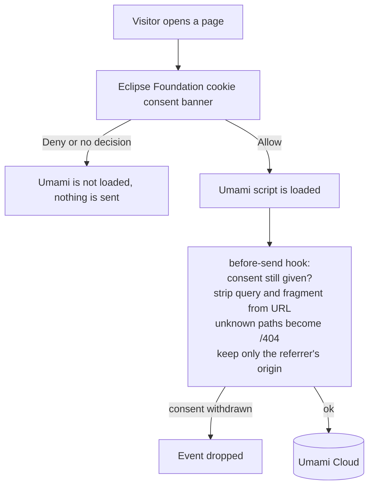

# Website analytics

This page explains how usage analytics work on <https://eclipse-tractusx.github.io>: which requirements they follow,
how they are built, and what is tracked and what is not.

Background and goals: [eclipse-tractusx/sig-release#1775](https://github.com/eclipse-tractusx/sig-release/issues/1775).

## Why

We want to know how the website is used, especially the KITs: which KITs and KIT pages are read, how often the
search finds nothing, which pages people enter through and where visitors come from. The numbers help KIT owners
and the project prioritize documentation work. They are reported in aggregate only; no individual visitor is tracked.

## Requirements

The website runs under the Eclipse Foundation, so it follows the
[Eclipse Foundation Hosted Services Privacy and Acceptable Usage Policy](https://www.eclipse.org/org/documents/eclipse-foundation-hosted-services-privacy-and-acceptable-usage-policy.pdf)
(v1.1) and the [Eclipse webdev guide on embedding analytics](https://webdev.eclipse.org/docs/solstice/?path=/docs/getting-started-embedding-analytics--docs).
The approach was clarified with the Eclipse Foundation in
[eclipsefdn/helpdesk#7844](https://gitlab.eclipse.org/eclipsefdn/helpdesk/-/work_items/7844).

| Requirement | How it is met |
|---|---|
| Only analytics tools approved by the Eclipse Foundation (Appendix A of the policy) | [Umami Cloud](https://umami.is) (`cloud.umami.is`), listed in Appendix A |
| Explicit consent through the Eclipse Foundation Cookie Consent Banner before any data is collected | The official banner is loaded on every page. Umami is only loaded after the visitor clicked "Allow". |
| The banner links to the Eclipse Foundation Privacy Policy | Built into the official banner |
| Use all available IP anonymisation features | Umami does not store IP addresses and sets no cookies |
| No personal information is transmitted to the analytics platform | Query strings and fragments are removed from URLs, paths that are not a page of the site are sent as `/404`, referrers are reduced to their origin, search terms are never sent (see below) |
| Footer with the Eclipse Foundation copyright notice and the links to the Eclipse Foundation website, Privacy Policy, Terms of Use, Compliance and Legal | Footer in [`docusaurus.config.js`](docusaurus.config.js) |
| All committers and the Eclipse Foundation get equal access to the data on request | Organizational: request access from the account owner (see [Access to the data](#access-to-the-data)) |

## How it works

1. **Consent banner.** [`docusaurus.config.js`](docusaurus.config.js) loads the banner script and stylesheet from
   `www.eclipse.org` on every page. The banner stores the decision in the cookie `eclipse_cookieconsent_status`
   (`allow` or `deny`). Visitors can change their decision at any time with the "Cookie settings" button that the
   banner shows at the bottom of the page.
2. **Loading Umami.** [`src/clientModules/analytics.js`](src/clientModules/analytics.js) runs on every page. It only
   adds the Umami script when the consent cookie is `allow`, either on page load or right after the visitor clicked
   "Allow".
3. **Checking every event.** Before Umami sends anything, the `before-send` hook in the same file checks the consent
   cookie again and drops the event if consent was withdrawn. It also removes the query string and fragment from the
   page URL and reduces the referrer to its origin, for example `https://www.google.com`. Paths that are not a page of
   the site (checked against the Docusaurus routes) are sent as `/404`: such paths are typed or linked by someone else
   and may contain anything, for example an e-mail address.
4. **Search outcome.** [`src/theme/SearchBar/index.js`](src/theme/SearchBar/index.js) wraps the Docusaurus search
   bar and passes every Algolia request and its response to the analytics module. When the visitor stopped typing
   for 1.5 seconds, the outcome of the newest request is recorded once, if it has completed and matches the text in
   the search field: `search` if it found something, `search-no-results` if not. Opening a result (click or Enter)
   or "See all results" records the search right away, and so does closing the dialog before the 1.5 seconds have
   passed; otherwise quickly opened results would be missing and the share of searches without results would be too
   high. Taking the outcome from the response
   of that very request, not from what the dialog shows or from an earlier search with the same text, keeps it
   correct when responses arrive late or out of order. A response only counts if consent was given when its request
   started and did not change until the outcome is recorded; requests started before consent, or before a withdrawal
   and a new consent, are ignored.
5. **Only on the production site.** Umami only sends data from `eclipse-tractusx.github.io` (`data-domains`).
   Pull request previews, which are built with a different base URL, do not load Umami at all. Local development
   (`npm start`) is never tracked.
6. **Do Not Track.** Umami respects the browser's Do Not Track setting (`data-do-not-track`).

## What is tracked

Only after the visitor allowed cookies:

| Data | Example | Used for |
|---|---|---|
| Page views, including client-side navigation; unknown paths as `/404` | `/docs-kits/kits/connector-kit/adoption-view` | Most visited pages, page views per KIT and KIT view (adoption, development, operation, changelog) |
| Page title | `Adoption View \| Eclipse Tractus-X` | Readable page names in reports |
| Origin of the referrer | `https://www.google.com` | Where visitors come from |
| Search outcome: event `search` (results found) or `search-no-results` | `search-no-results` | How often the search finds nothing |
| Information Umami derives from the request | Country, browser, operating system, device type, screen size, language | Aggregated reports |

Umami derives visits and sessions from a salted hash, without cookies and without storing the IP address. Entry pages, exit pages and time on page are calculated from the page views.

## What is not tracked

- Nothing at all without consent, or after consent was withdrawn.
- No cookies are set by Umami and no IP addresses are stored.
- No search terms. What visitors type into the search may contain personal information, so only the outcome is
  recorded.
- No query strings or fragments of page URLs (for example `?email=...` or `#token=...`), and no paths that are not
  a page of the site (for example `/jane.doe@example.com`, sent as `/404`).
- No full referrer URLs, only their origin.
- No clicks, scrolling, form input or other interactions.
- No user accounts, names, e-mail addresses or other personal information.
- No pull request previews and no local builds.

## Configuration

| Setting | Where | Default |
|---|---|---|
| Umami website id | `umamiWebsiteId` in [`docusaurus.config.js`](docusaurus.config.js), environment variable `UMAMI_WEBSITE_ID` | The id of the Tractus-X website in Umami Cloud |
| Umami script | `umamiScriptUrl`, environment variable `UMAMI_SCRIPT_URL` | `https://cloud.umami.is/script.js` |
| Tracked host | derived from `SITE_URL` | `eclipse-tractusx.github.io` |

The website id is not a secret, it is part of every tracked page. To build the site without analytics, set
`UMAMI_WEBSITE_ID` to an empty string.

## Access to the data

The data is available in the Umami Cloud dashboard. As required by the policy, committers of the project and the
Eclipse Foundation get access on request. Ask the account owner (@stephanbcbauer), see the feature team in
[sig-release#1775](https://github.com/eclipse-tractusx/sig-release/issues/1775).

## Testing

1. Open the website in a private browser window. The cookie banner is shown and the network tab shows no requests to
   `umami.is`.
2. Click "Deny" and navigate through some pages: still no requests to `umami.is`.
3. Click "Cookie settings", then "Allow": the Umami script is loaded and every page view sends a request to
   `gateway.umami.is/api/send`.
4. Search for something without results: an event `search-no-results` is sent, without the search term.
5. Click "Cookie settings", then "Deny": no further requests are sent.

Requests are only sent on `eclipse-tractusx.github.io`. To test locally, start the site with
`SITE_URL=http://localhost:3000 npm start`; this sends real data to Umami with the host name `localhost`.

## Known limitations

- The banner stores the visitor's decision for the browser session only. Its 90-day cookie is set for the domain
  `.github.io`, which browsers reject because it is a public suffix, so the banner is shown again in every new
  browser session.
- Changes to the analytics must keep this page and the requirements above in sync.

## NOTICE

This work is licensed under the [CC-BY-4.0](https://creativecommons.org/licenses/by/4.0/legalcode).

- SPDX-License-Identifier: CC-BY-4.0
- SPDX-FileCopyrightText: 2026 Contributors to the Eclipse Foundation
- Source URL: <https://github.com/eclipse-tractusx/eclipse-tractusx.github.io>
