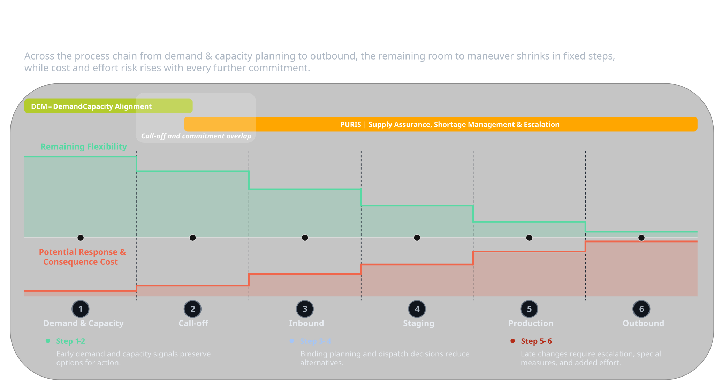

To ensure supply chain resilience each phase of the production process contains operational commitment points. A commitment point describes the moment at which a previously flexible planning option becomes binding and can only be changed with additional effort, cost, time loss.

As production approaches, flexibility decreases while the potential impact of disruptions increases. Earlier visibility therefore expands the economically viable range of corrective actions.

Figure 1: *Relationship between flexibility, commitment and potential disruption costs throughout the production process*

## NOTICE

This work is licensed under the [CC-BY-4.0](https://creativecommons.org/licenses/by/4.0/legalcode)

- SPDX-License-Identifier: CC-BY-4.0
- SPDX-FileCopyrightText: 2026 Fraunhofer-Gesellschaft zur Foerderung der angewandten Forschung e.V. (represented by Fraunhofer ISST)  
- SPDX-FileCopyrightText: 2026 Volkswagen AG  
- Source URL: [https://github.com/eclipse-tractusx/eclipse-tractusx.github.io/docs-kits/kits/puris-kit/adoption-view/puris-and-dcm/dynamics-and-cost-drivers.md](https://github.com/eclipse-tractusx/eclipse-tractusx.github.io/docs-kits/kits/puris-kit/adoption-view/puris-and-dcm/dynamics-and-cost-drivers.md)
