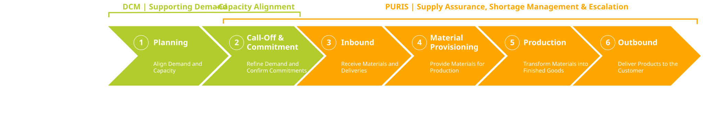
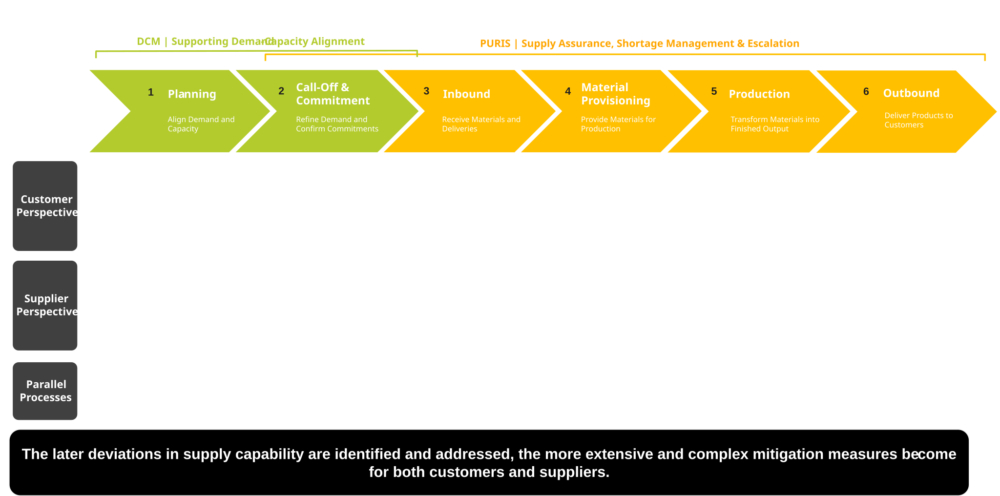

## Production Process in Context of DCM and PURIS

The differences between PURIS and DCM become apparent when viewed along the production process.

The production process can be structured into six phases: Planning, Call-Off & Commitment, Inbound, Material Provisioning, Production and Outbound.

Across these phases, the degree of flexibility continuously decreases while operational commitment and the potential cost of disruptions and actions to mitigate disruptions increase. DCM primarily supports demand-capacity alignment during the planning-oriented phases of the process. PURIS extends this perspective into operational execution by providing transparency into supply capability, supporting shortage management and enabling collaborative mitigation measures when supply risks materialize.

The transition from collaborative planning to operational execution occurs at the point where demand becomes binding through customer call-offs and supplier commitments. From this stage onward, operational constraints increasingly determine the available response options.

Figure 1: *Production process perspective and positioning of DCM and PURIS across six operational phases*

## Customer-Supplier Interaction in the Production Process

Customer and supplier processes are not strictly sequential. Instead, they operate in parallel and continuously influence each other as the production date approaches.

On the customer side, activities typically include demand planning, call-off management, inbound monitoring, mitigation planning and production steering. On the supplier side, activities include capacity validation, supply preparation, inventory monitoring, operational production control and customer communication.

The closer a potential shortage moves towards production, the more costly and comprehensive mitigation measures become for both parties.

The interaction can be described as a bilateral exchange between consumer and provider, depending on the specific process step and information need. In this context, PURIS supports the operational management of deviations within the running customer-supplier relationship, while DCM supports earlier alignment of demand and capacity before operational supply risk materializes.

Figure 2: *Positioning of DCM and PURIS across the production process, illustrating typical customer and supplier activities, collaborative mitigation measures.*

## NOTICE

This work is licensed under the [CC-BY-4.0](https://creativecommons.org/licenses/by/4.0/legalcode)

- SPDX-License-Identifier: CC-BY-4.0
- SPDX-FileCopyrightText: 2026 Fraunhofer-Gesellschaft zur Foerderung der angewandten Forschung e.V. (represented by Fraunhofer ISST)  
- SPDX-FileCopyrightText: 2026 Volkswagen AG  
- Source URL: [https://github.com/eclipse-tractusx/eclipse-tractusx.github.io/docs-kits/kits/puris-kit/adoption-view/puris-and-dcm/production-context.md](https://github.com/eclipse-tractusx/eclipse-tractusx.github.io/docs-kits/kits/puris-kit/adoption-view/puris-and-dcm/production-context.md)
