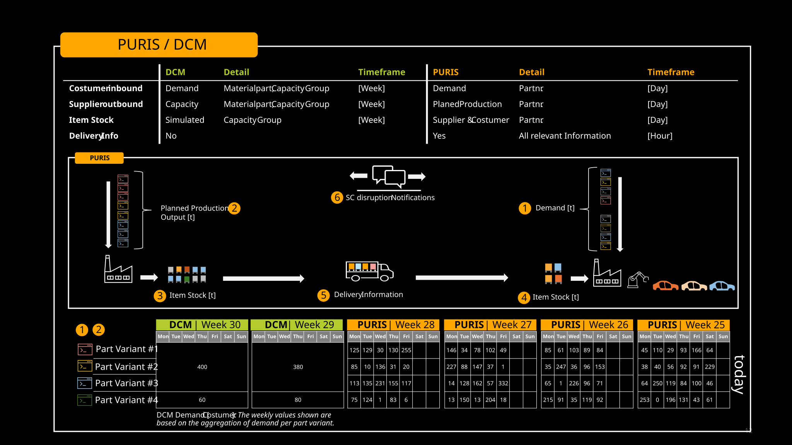

Catena-X enables comprehensive transparency across the entire supply network while maintaining sensitive data handling between partners by extending beyond the four-week planning horizon of PURIS.
In this context, DCM and PURIS complement each other with the shared goal of avoiding capacity bottlenecks or supply shortages.

However, due to their respective time focuses, both standards emphasize different types of information. While DCM primarily considers capacities at the material group level with weekly demand and capacity buckets, PURIS focuses on daily production and supply and demand data at the single material number level.

By combining these two perspectives, companies can gain a holistic view of supply and demand dynamics bridging strategic capacity planning with operational execution. This synergy supports proactive decision-making and strengthens the overall resilience of the supply chain.

Figure 1: *Combination of PURIS and DCM for a better supply chain transparency*

## NOTICE

This work is licensed under the [CC-BY-4.0](https://creativecommons.org/licenses/by/4.0/legalcode)

- SPDX-License-Identifier: CC-BY-4.0  
- SPDX-FileCopyrightText: 2024 Contributors of the Eclipse Foundation  
- SPDX-FileCopyrightText: 2024 Fraunhofer-Gesellschaft zur Foerderung der angewandten Forschung e.V. (represented by Fraunhofer ISST)  
- SPDX-FileCopyrightText: 2024 Volkswagen AG  
- SPDX-FileCopyrightText: 2025 WITTE Automotive GmbH  
- SPDX-FileCopyrightText: 2025 Ford Werke GmbH  
- SPDX-FileCopyrightText: 2025 Robert Bosch Manufacturing Solutions GmbH  
- SPDX-FileCopyrightText: 2025 IBM Deutschland GmbH
- Source URL: [https://github.com/eclipse-tractusx/eclipse-tractusx.github.io/docs-kits/kits/puris-kit/adoption-view/puris-and-dcm/puris-and-dcm.md](https://github.com/eclipse-tractusx/eclipse-tractusx.github.io/docs-kits/kits/puris-kit/adoption-view/puris-and-dcm/puris-and-dcm.md)
